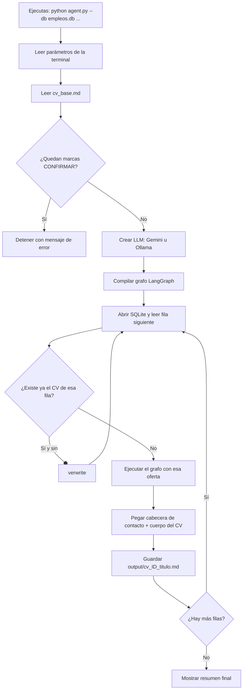
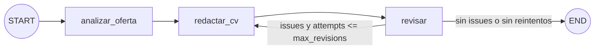

# Documentación del Agente Generador de CVs

## 1. ¿Qué hace?

Lee ofertas de empleo desde una base SQLite y, **por cada fila**, genera un CV nuevo en Markdown adaptado a esa oferta. El CV se escribe con un LLM (Gemini por API u Ollama local) y se construye **solo con tu experiencia real**, definida en `cv_base.md`.

## 2. Archivos del proyecto

| Archivo | Para qué sirve |
|---|---|
| `render.py` | Convierte el CV en Markdown a HTML/PDF con diseño (colores, tipografía, fechas alineadas, tabla de habilidades). Cambia `ACCENT` para otro color. |
| `ejemplo_cv_con_diseno.pdf` | Muestra del resultado visual. |
| `agent.py` | Todo el programa: LLM, grafo, lectura de la base de datos y bucle principal. |
| `cv_base.md` | Tu experiencia real. Es la **única fuente de verdad**: el agente no puede usar nada que no esté aquí. |
| `requirements.txt` | Librerías a instalar con `pip install -r requirements.txt`. |
| `DOCUMENTACION.md` | Este documento. |
| `output/` | Carpeta que se crea sola; contiene un `.md` por oferta. |

## 3. Conceptos clave (para un primer agente)

- **LLM (modelo de lenguaje):** el "cerebro" que escribe texto. Aquí puede ser Gemini (nube) o Gemma vía Ollama (tu PC).
- **LangChain:** librería que da una interfaz común a distintos LLM. Gracias a ella, `llm.invoke(mensajes)` funciona igual con Gemini y con Ollama.
- **LangGraph:** librería para organizar un agente como un **grafo**: pasos (nodos) conectados por flechas (aristas). Permite ciclos, como "redactar → revisar → volver a redactar".
- **Nodo:** una función que hace un paso del trabajo.
- **Arista:** la flecha que dice qué nodo sigue. Puede ser fija o **condicional** (decide según el estado).
- **Estado (`CVState`):** un diccionario compartido que viaja por el grafo. Cada nodo lee lo que necesita y devuelve solo lo que cambia.
- **Prompt:** las instrucciones que se envían al LLM. Hay un prompt de *sistema* (rol y reglas) y uno de *usuario* (los datos concretos).

## 4. Flujo completo

### 4.1 Visión general (programa completo)



### 4.2 El grafo (lo que ocurre dentro de cada oferta)



### 4.3 Qué hace cada nodo

| Nodo | Entrada (lee del estado) | Qué hace el LLM | Salida (escribe al estado) |
|---|---|---|---|
| `analizar_oferta` | `job_text` | Extrae cargo, requisitos, palabras clave ATS, responsabilidades e idioma. | `analysis` |
| `redactar_cv` | `base_cv`, `job_text`, `analysis`, y si hay reintento: `issues` + `cv_body` previo | Escribe el CV usando solo el CV base y las reglas anti-invención. | `cv_body`, `attempts + 1` |
| `revisar` | `base_cv`, `cv_body` | Actúa de auditor: compara y responde en JSON `{"ok": ..., "issues": [...]}`. | `issues` (vacía si todo OK) |

### 4.4 Cómo evoluciona el estado (ejemplo con un reintento)

| Momento | `analysis` | `cv_body` | `issues` | `attempts` |
|---|---|---|---|---|
| Estado inicial | vacío | vacío | `[]` | 0 |
| Tras `analizar_oferta` | análisis de la oferta | vacío | `[]` | 0 |
| Tras `redactar_cv` (1.ª vez) | igual | borrador 1 | `[]` | 1 |
| Tras `revisar` (falla) | igual | borrador 1 | `["inventó una certificación"]` | 1 |
| `decidir`: hay issues y `1 <= max_revisions(1)` | vuelve a `redactar_cv` | | | |
| Tras `redactar_cv` (2.ª vez) | igual | borrador 2 (corregido) | `["inventó..."]` | 2 |
| Tras `revisar` (OK) | igual | borrador 2 | `[]` | 2 |
| `decidir`: sin issues | **END** | | | |

Si tras agotar los reintentos el auditor aún ve problemas, el flujo termina igual y el archivo incluye al final un comentario `<!-- REVISAR MANUALMENTE ... -->`.

## 5. Referencia de funciones

| Función | Qué hace | Parámetros | Devuelve |
|---|---|---|---|
| `build_llm` | Crea el modelo según el proveedor. Único lugar que distingue Gemini de Ollama. | `provider`, `model`, `temperature`, `base_url` | Objeto chat de LangChain |
| `msg_text` | Extrae el texto de la respuesta del LLM (sea string o lista de bloques). | `msg` | `str` |
| `strip_fences` | Quita las vallas ```` ``` ```` que el modelo a veces añade. | `text` | `str` |
| `parse_review` | Interpreta el JSON del auditor; si falla, asume `ok=True`. | `text` | `dict` con `ok` e `issues` |
| `CVState` | Define la forma del estado compartido del grafo. | , | , |
| `build_graph` | Define nodos, aristas y la decisión; compila el grafo. | `llm`, `max_revisions` | Grafo ejecutable |
| `analizar_oferta` / `redactar_cv` / `revisar` | Los tres nodos (definidos dentro de `build_graph`). | `state` | `dict` con claves a actualizar |
| `decidir` | Arista condicional: reintentar o terminar. | `state` | `"redactar_cv"` o `END` |
| `fetch_rows` | Lee la base SQLite y entrega una fila a la vez. | `db_path`, `table`, `query` | Generador de `dict` |
| `row_to_text` | Convierte una fila en texto `columna: valor`. | `row` | `str` |
| `slugify` | Limpia un texto para usarlo en un nombre de archivo. | `text`, `max_len` | `str` |
| `main` | Orquesta todo el programa. | (lee la terminal) | , |

## 6. Referencia de parámetros de la terminal

| Parámetro | Obligatorio | Por defecto | Qué hace |
|---|---|---|---|
| `--db` | **Sí** | , | Ruta a la base SQLite con las ofertas. |
| `--provider` | No | `ollama` | `gemini` o `ollama`. |
| `--model` | No | `gemini-2.5-flash` / `gemma4` | Nombre del modelo del proveedor elegido. |
| `--ollama-url` | No | `http://localhost:11434` | Dirección del servidor Ollama. |
| `--num-ctx` | No | `16384` | Contexto (tokens) que Ollama reserva por petición. Si es muy bajo, recorta tu CV base en silencio. Solo Ollama. |
| `--formats` | No | `md,html` | Formatos de salida: `md`, `html`, `pdf` (separados por coma). `html` se abre en el navegador y se guarda como PDF con Ctrl+P. `pdf` directo requiere WeasyPrint. |
| `--temperature` | No | `0.3` | Creatividad: 0 literal, 1 muy creativo. Para CVs, 0.2 a 0.4. |
| `--cv` | No | `cv_base.md` | Archivo con tu experiencia real. |
| `--table` | No | `jobs` | Tabla con las ofertas. |
| `--query` | No | , | SQL propio (reemplaza a `--table`); sirve para filtrar. |
| `--id-col` | No | `id` | Columna para identificar la oferta en el nombre del archivo. |
| `--title-col` | No | `title` | Columna con el cargo, también para el nombre del archivo. |
| `--out` | No | `output` | Carpeta de salida. |
| `--max-revisions` | No | `1` | Reescrituras permitidas si el auditor encuentra problemas. |
| `--overwrite` | No | desactivado | Regenera CVs que ya existen. |

Otros ajustes (no son parámetros de la terminal):
- Variable de entorno `GOOGLE_API_KEY`: clave de Gemini.
- Constante `CONTACT_HEADER` en `agent.py`: tus datos de contacto.
- Constantes `ANALYZE_SYSTEM`, `WRITE_RULES`, `REVIEW_SYSTEM`: los prompts. Aquí cambias el "comportamiento" del agente.

## 7. Mecanismos de seguridad

1. **Marcas `[CONFIRMAR ...]`:** si quedan en `cv_base.md`, el programa no arranca. Evita enviar cifras sin validar.
2. **Reglas anti-invención** en `WRITE_RULES`: el redactor solo puede usar hechos del CV base.
3. **Auditor (`revisar`):** segundo paso que compara el CV con el CV base y pide correcciones.
4. **Contacto fuera del LLM:** `CONTACT_HEADER` se agrega por código, así que el modelo no lo modifica ni lo inventa.
5. **Aviso manual:** si persisten problemas, el archivo los deja anotados al final.
6. **Tolerancia a fallos:** un error en una oferta no detiene el lote, y las ofertas ya generadas se omiten al relanzar.

## 8. Cómo ejecutarlo

```bash
pip install -r requirements.txt

# Ollama (local)
ollama pull gemma4
python agent.py --provider ollama --model gemma4 --db empleos.db --table jobs

# Gemini (API)
export GOOGLE_API_KEY="tu_clave"
python agent.py --provider gemini --db empleos.db --table jobs

# Con nombres de columna propios y filtro
python agent.py --db empleos.db --query "SELECT * FROM ofertas WHERE pais='CL'" \
    --id-col oferta_id --title-col cargo
```

## 9. Problemas frecuentes

| Síntoma | Causa probable | Solución |
|---|---|---|
| "cifras sin confirmar" | Quedan marcas `[CONFIRMAR ...]` en `cv_base.md`. | Confirma, corrige o elimina cada una. |
| "Falta GOOGLE_API_KEY" | La variable de entorno no está definida. | `export GOOGLE_API_KEY=...` |
| Error de conexión con Ollama | Ollama no está corriendo o el modelo no está descargado. | Abre Ollama y ejecuta `ollama pull <modelo>`. |
| Los nombres de archivo salen `cv_1_sin_titulo` | La columna del título no se llama `title`. | Usa `--title-col`. |
| El CV ignora partes de tu experiencia (Ollama) | El contexto es muy pequeño y Ollama cortó el prompt. | Sube `--num-ctx` (ej. 32768) si tu GPU/RAM lo permite. |
| CV genérico o con poco detalle | `cv_base.md` es escaso. | Agrega más detalle y logros reales. |
| Siempre aparece el aviso del auditor con Gemma | El modelo local es débil para auditar o devuelve JSON malo. | Usa `--provider gemini` para el lote final, o revisa a mano. |

## 10. Ideas para ampliar el agente (siguientes pasos de aprendizaje)

- Agregar un nodo que puntúe la compatibilidad CV–oferta (0 a 100) y descarte las ofertas con baja coincidencia.
- Generar también una carta de presentación como un cuarto nodo.
- Exportar a PDF o DOCX además de Markdown.
- Usar `with_structured_output` (con Gemini) para que el auditor devuelva JSON garantizado.
- Guardar en SQLite el estado de cada oferta (generada, revisada, postulada).

## 11. Diseño y contenido del CV (módulo `render.py`)

**Cómo funciona:** el LLM escribe Markdown con una estructura fija (`WRITE_RULES`) y `render.py` le aplica el diseño. Por eso no hay que cambiar el diseño en cada CV.

La estructura que el redactor debe respetar:

| Markdown | Se ve como |
|---|---|
| `## Sección` | Título en mayúsculas con color de acento y línea inferior |
| `### Cargo — Empresa` + línea `*Fechas \| Ciudad*` | Cargo a la izquierda y fechas a la derecha |
| `- **Categoría:** a, b, c` | Tabla de habilidades: etiqueta de color y lista alineada |
| Primera línea `# [NOMBRE]` y contacto | Nombre grande y línea de contacto gris |

**PDF directo:** `pip install weasyprint`. En Windows exige instalar GTK; si te da problemas, usa `--formats md,html` y guarda el HTML como PDF desde el navegador (Ctrl+P). El diseño es de una columna, sin tablas ni imágenes, para que los sistemas ATS lo lean bien.

**Mejoras de contenido en los prompts:** el resumen ahora debe incluir evidencia concreta para la oferta, hay un bloque de "Logros destacados" con las 3 cifras más relevantes, y las viñetas siguen la fórmula verbo + qué + cómo + resultado. También se prohíben niveles de dominio ("Advanced", "Expert") y habilidades que no estén en `cv_base.md`, y el auditor los marca.
